<h2 align="center">hi, i'm jay 👋</h2>

i run <a href="https://dctechltd.com"><b>DC Tech</b></a>. full-stack developer: front end, back end, databases, payments, ai pipelines, integrations, smart contracts and deployment. 
i scope the work, design how it fits together, and use ai tooling to ship it faster, then check it properly before anything goes live.

## live demos

every demo below is live and clickable. all use fictional brands and data. code walkthroughs on request.

### ai & automation

<table>
  <tr>
    <td width="50%" valign="top">
      <a href="https://geo-exploration-agent.vercel.app">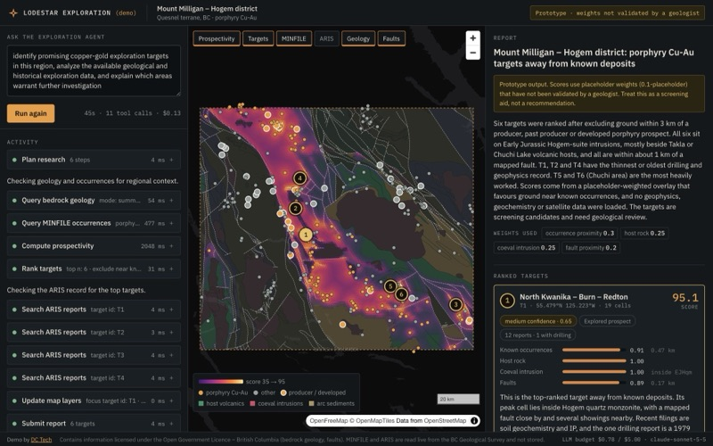</a>
       <b>Lodestar Exploration</b> 
      aI exploration agent that ranks porphyry copper-gold targets on a map and cites every claim 
      ↗ <a href="https://geo-exploration-agent.vercel.app">geo-exploration-agent.vercel.app</a>
    </td>
    <td width="50%" valign="top">
      <a href="https://lunero-ad-agent.vercel.app">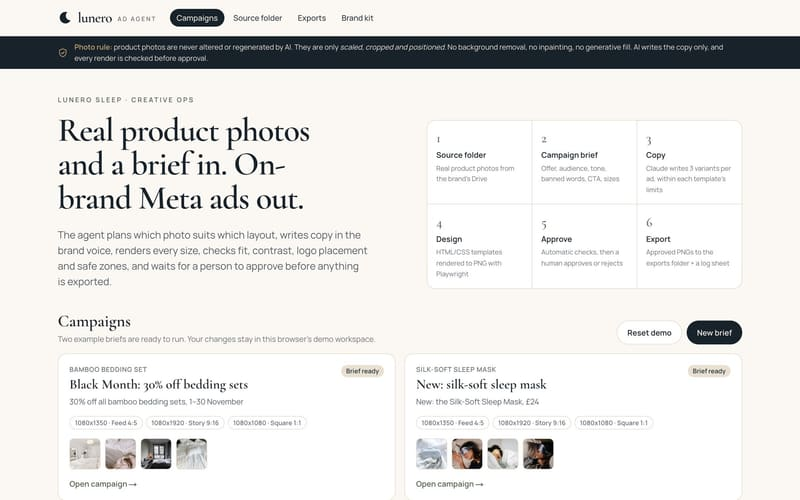</a>
       <b>Lunero Ad Agent</b> 
      real product photos + a brief into on-brand Meta ads, with checks and approval 
      ↗ <a href="https://lunero-ad-agent.vercel.app">lunero-ad-agent.vercel.app</a>
    </td>
  </tr>
  <tr>
    <td width="50%" valign="top">
      <a href="https://listing-video-demo.vercel.app">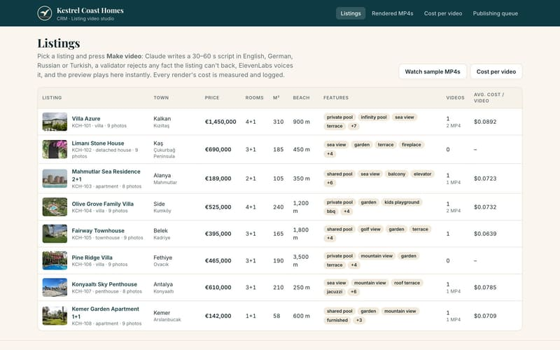</a>
       <b>Kestrel Coast Homes</b> 
      one-click property videos in 4 languages, with the cost of every video measured 
      ↗ <a href="https://listing-video-demo.vercel.app">listing-video-demo.vercel.app</a>
    </td>
    <td width="50%" valign="top">
      <a href="https://invoice-order-worker-demo.vercel.app">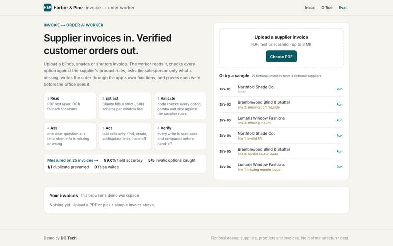</a>
       <b>Harbor & Pine</b> 
      aI worker that turns supplier invoices into verified orders 
      ↗ <a href="https://invoice-order-worker-demo.vercel.app">invoice-order-worker-demo.vercel.app</a>
    </td>
  </tr>
  <tr>
    <td width="50%" valign="top">
      <a href="https://grounded-analytics-demo.vercel.app">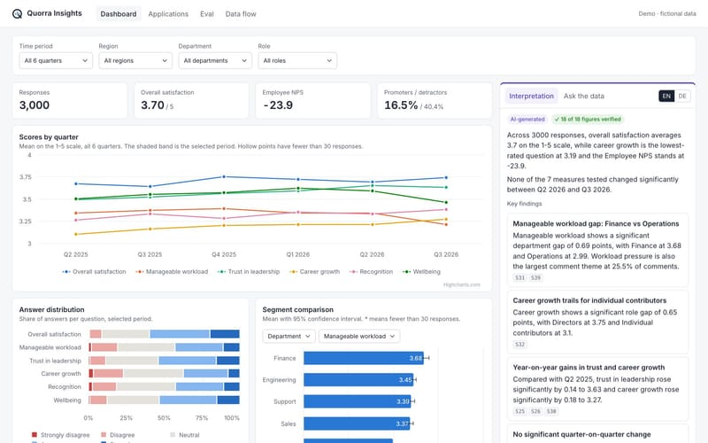</a>
       <b>Quorra Insights</b> 
      aI survey insights where every figure is checked against the data 
      ↗ <a href="https://grounded-analytics-demo.vercel.app">grounded-analytics-demo.vercel.app</a>
    </td>
    <td width="50%" valign="top">
      <a href="https://ad-studio-demo-pearl.vercel.app">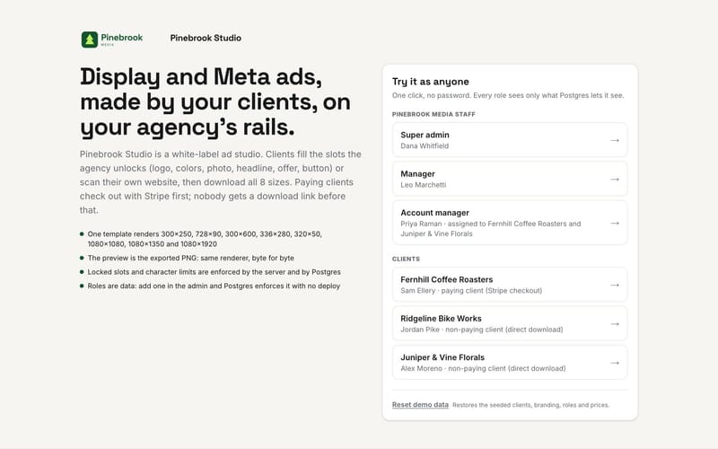</a>
       <b>Pinebrook Studio</b> 
      white-label ad builder: locked templates, 8 sizes, AI copy, pay before download 
      ↗ <a href="https://ad-studio-demo-pearl.vercel.app">ad-studio-demo-pearl.vercel.app</a>
    </td>
  </tr>
  <tr>
    <td width="50%" valign="top">
      <a href="https://estate-readiness-demo.vercel.app">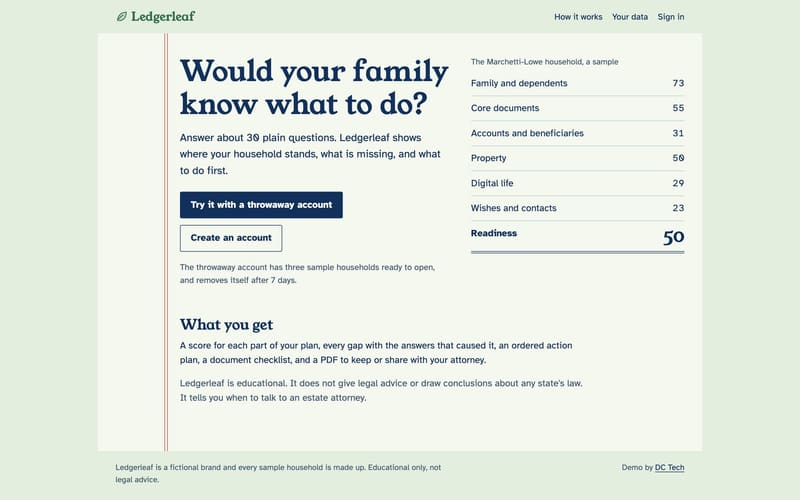</a>
       <b>Ledgerleaf</b> 
      branching questionnaire with a scored report and checked AI summary 
      ↗ <a href="https://estate-readiness-demo.vercel.app">estate-readiness-demo.vercel.app</a>
    </td>
    <td width="50%" valign="top">
      <a href="https://book-reels-pipeline.vercel.app">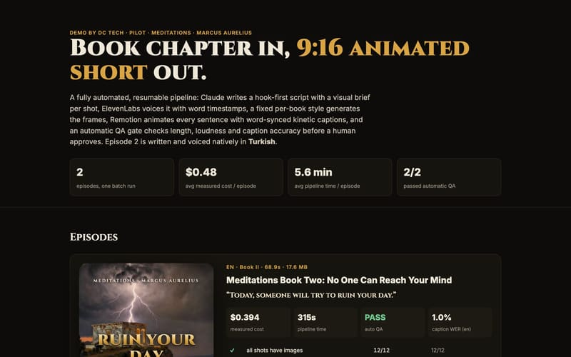</a>
       <b>Book Reels</b> 
      book chapter in, 9:16 animated short out: script, voice, frames, captions and QA, about $0.48 an episode 
      ↗ <a href="https://book-reels-pipeline.vercel.app">book-reels-pipeline.vercel.app</a>
    </td>
  </tr>
  <tr>
    <td width="50%" valign="top">
      <a href="https://solene-prompts-demo.vercel.app">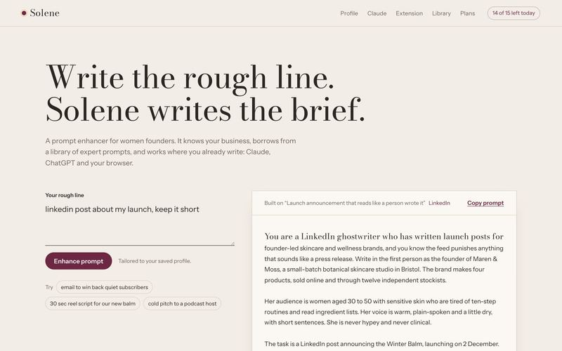</a>
       <b>Solene Prompts</b> 
      prompt enhancer inside Claude, ChatGPT and the browser: remote MCP server plus a Chrome extension 
      ↗ <a href="https://solene-prompts-demo.vercel.app">solene-prompts-demo.vercel.app</a>
    </td>
    <td width="50%" valign="top"></td>
  </tr>
</table>

### saas & data

<table>
  <tr>
    <td width="50%" valign="top">
      <a href="https://boat-club-saas-demo.vercel.app">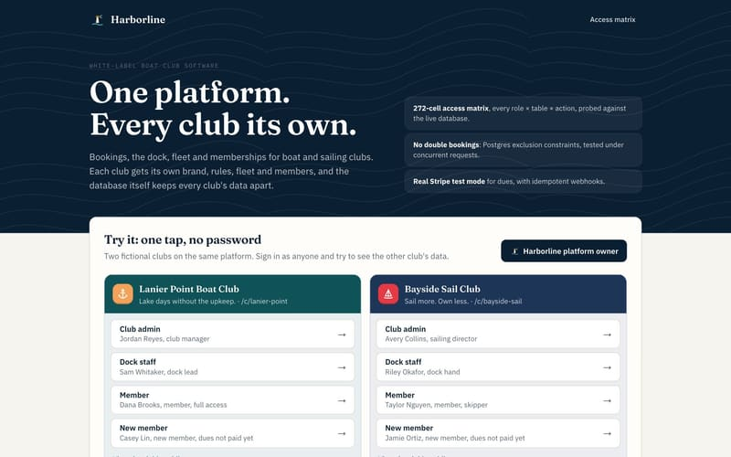</a>
       <b>Harborline</b> 
      white-label boat club platform where the database keeps every club apart 
      ↗ <a href="https://boat-club-saas-demo.vercel.app">boat-club-saas-demo.vercel.app</a>
    </td>
    <td width="50%" valign="top">
      <a href="https://bid-intel-migration-demo.vercel.app">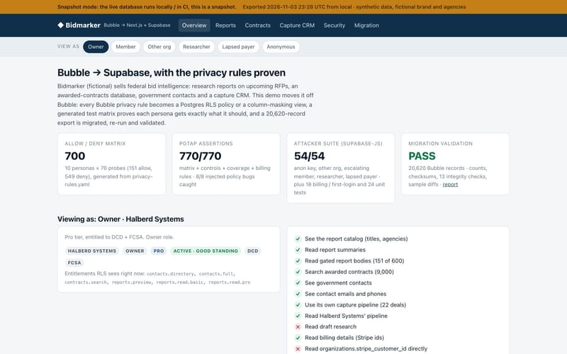</a>
       <b>Bidmarker</b> 
      bubble → Supabase migration with every privacy rule proven in SQL 
      ↗ <a href="https://bid-intel-migration-demo.vercel.app">bid-intel-migration-demo.vercel.app</a>
    </td>
  </tr>
  <tr>
    <td width="50%" valign="top">
      <a href="https://catalog-integrity-demo.vercel.app">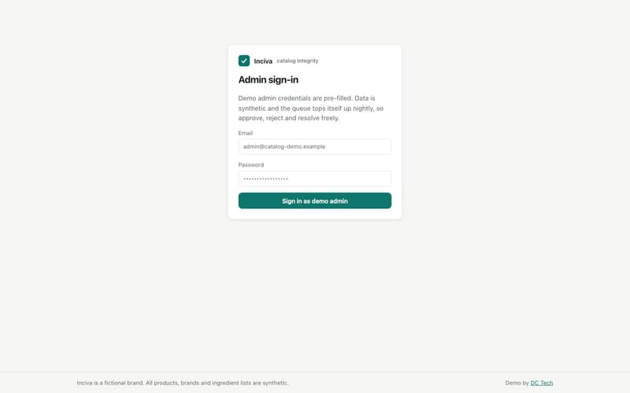</a>
       <b>Inciva</b> 
      database-enforced integrity for a 50k-product catalog 
      ↗ <a href="https://catalog-integrity-demo.vercel.app">catalog-integrity-demo.vercel.app</a>
    </td>
    <td width="50%" valign="top">
      <a href="https://job-reliability-demo.vercel.app">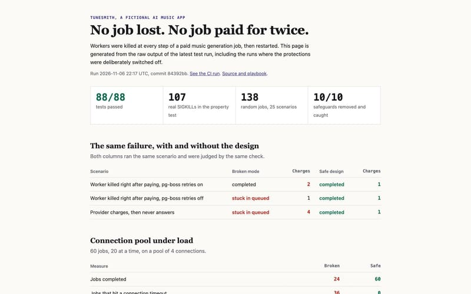</a>
       <b>Tunesmith</b> 
      background jobs that are never lost and never paid for twice 
      ↗ <a href="https://job-reliability-demo.vercel.app">job-reliability-demo.vercel.app</a>
    </td>
  </tr>
  <tr>
    <td width="50%" valign="top">
      <a href="https://ehr-ghl-sync-demo.vercel.app">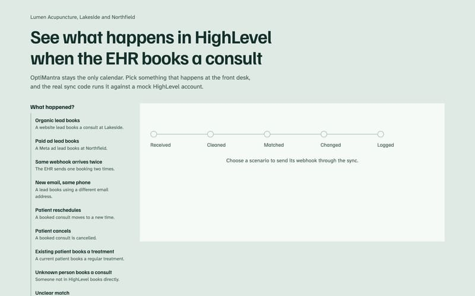</a>
       <b>Lumen booking sync</b> 
      eHR → CRM booking sync with clinical data stripped on arrival 
      ↗ <a href="https://ehr-ghl-sync-demo.vercel.app">ehr-ghl-sync-demo.vercel.app</a>
    </td>
    <td width="50%" valign="top">
      <a href="https://eviction-updates-demo.vercel.app">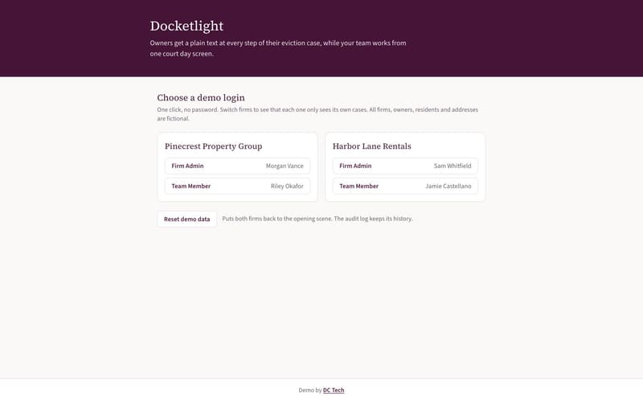</a>
       <b>Docketlight</b> 
      multi-firm SaaS that texts owners as cases progress 
      ↗ <a href="https://eviction-updates-demo.vercel.app">eviction-updates-demo.vercel.app</a>
    </td>
  </tr>
  <tr>
    <td width="50%" valign="top">
      <a href="https://rules-registry-demo.vercel.app">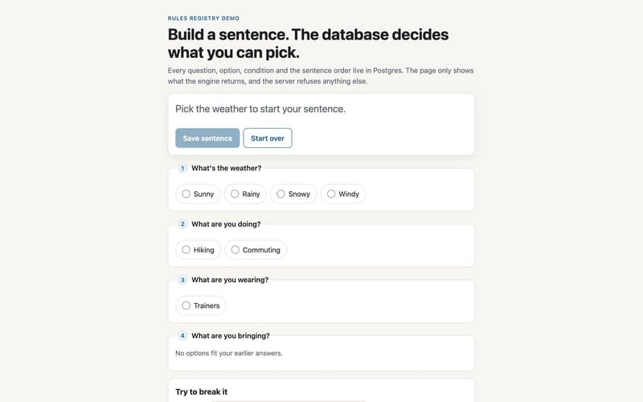</a>
       <b>Rules Registry</b> 
      sentence builder whose rules all live in Postgres 
      ↗ <a href="https://rules-registry-demo.vercel.app">rules-registry-demo.vercel.app</a>
    </td>
    <td width="50%"></td>
  </tr>
</table>

### commerce & bookings

<table>
  <tr>
    <td width="50%" valign="top">
      <a href="https://garment-booking-demo.vercel.app">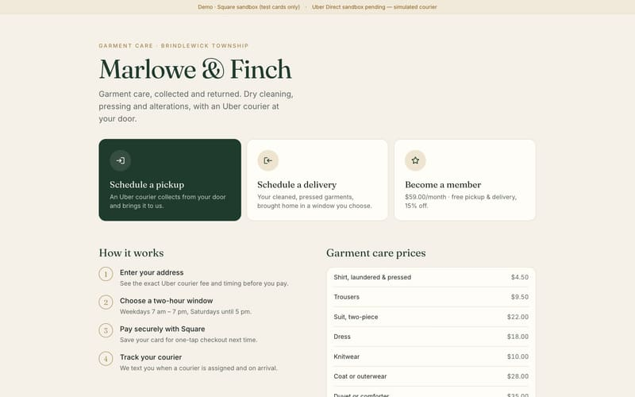</a>
       <b>Marlowe & Finch</b> 
      courier pickup and delivery booking with Square payments and memberships 
      ↗ <a href="https://garment-booking-demo.vercel.app">garment-booking-demo.vercel.app</a>
    </td>
    <td width="50%" valign="top">
      <a href="https://vet-rewards-demo.vercel.app">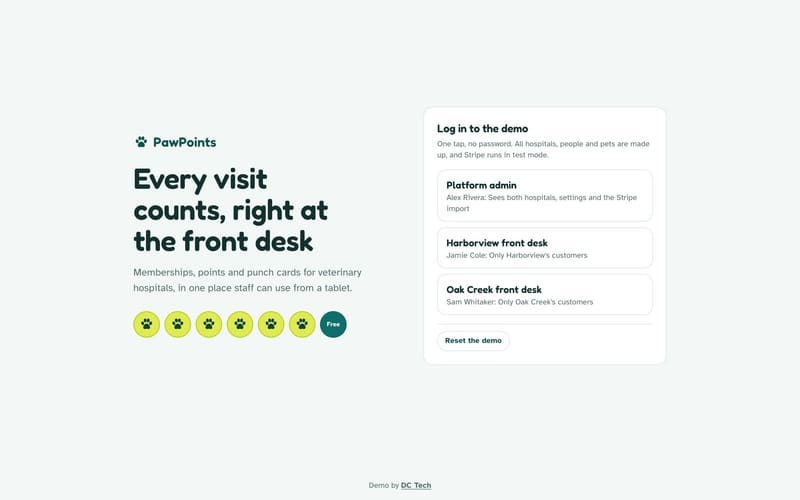</a>
       <b>PawPoints</b> 
      memberships, points and punch cards for vet front desks 
      ↗ <a href="https://vet-rewards-demo.vercel.app">vet-rewards-demo.vercel.app</a>
    </td>
  </tr>
  <tr>
    <td width="50%" valign="top">
      <a href="https://oneclick-upsell-demo.vercel.app">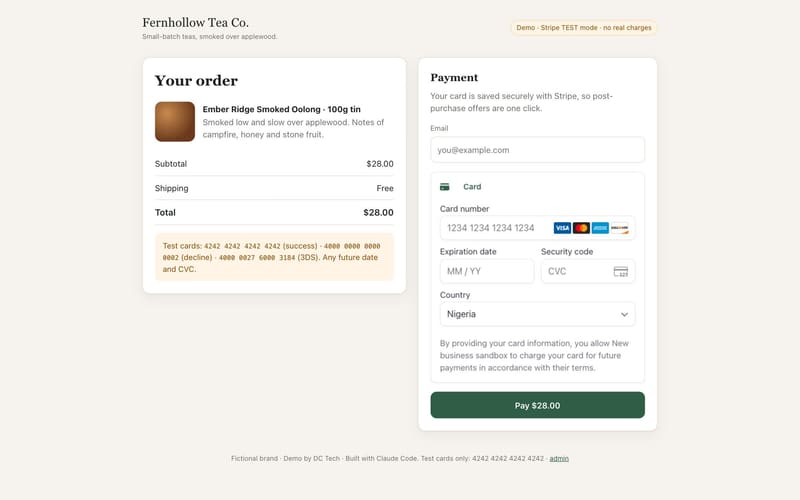</a>
       <b>Fernhollow Tea Co.</b> 
      one-click post-purchase upsell on the saved card, no double charges 
      ↗ <a href="https://oneclick-upsell-demo.vercel.app">oneclick-upsell-demo.vercel.app</a>
    </td>
    <td width="50%" valign="top">
      <a href="https://scout-a11y-demo.vercel.app">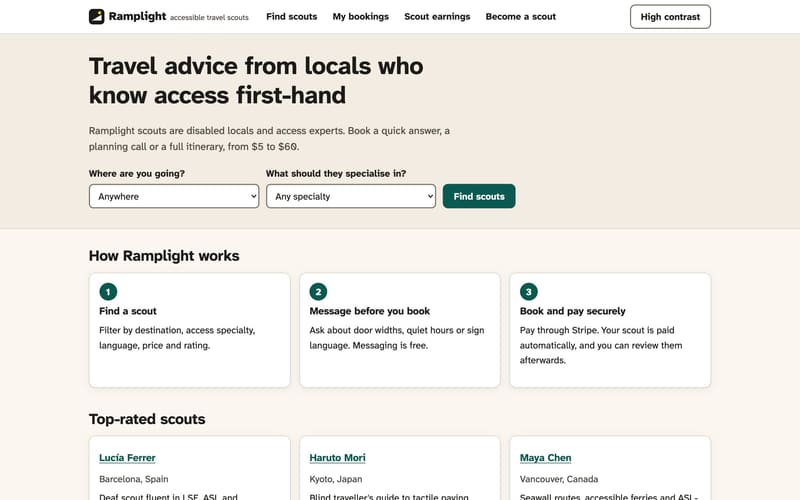</a>
       <b>Ramplight</b> 
      accessible marketplace with Stripe Connect payouts 
      ↗ <a href="https://scout-a11y-demo.vercel.app">scout-a11y-demo.vercel.app</a>
    </td>
  </tr>
  <tr>
    <td width="50%" valign="top">
      <a href="https://courier-quote-tool.vercel.app">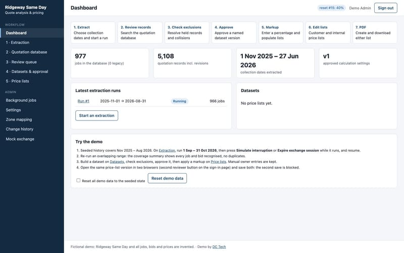</a>
       <b>Ridgeway Same Day</b> 
      courier quote analysis in PHP: clean data, approve it, turn it into price lists 
      ↗ <a href="https://courier-quote-tool.vercel.app">courier-quote-tool.vercel.app</a>
    </td>
    <td width="50%"></td>
  </tr>
</table>

### interactive & on-device

<table>
  <tr>
    <td width="50%" valign="top">
      <a href="https://dice-live-demo.vercel.app">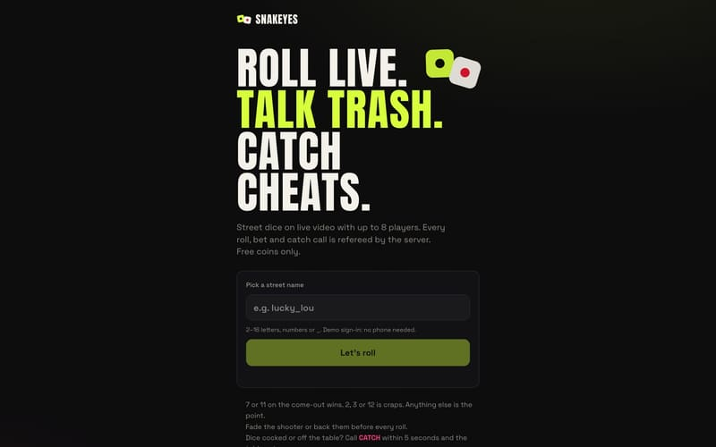</a>
       <b>SNAKEYES</b> 
      live-video multiplayer dice with a server-refereed game engine 
      ↗ <a href="https://dice-live-demo.vercel.app">dice-live-demo.vercel.app</a>
    </td>
    <td width="50%" valign="top">
      <a href="https://vision-distance-demo.vercel.app">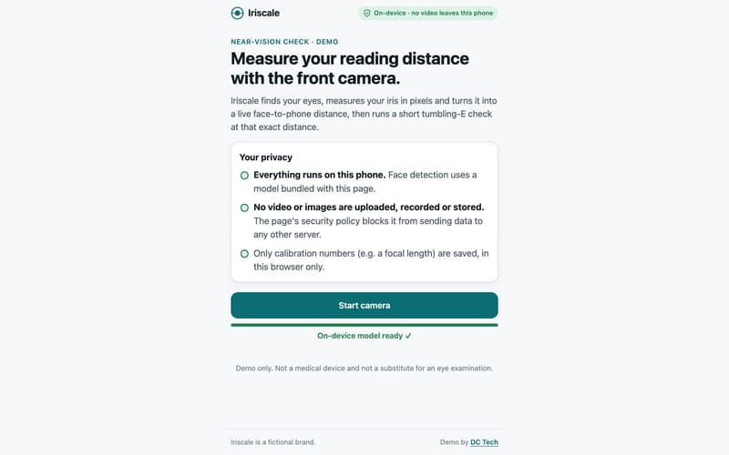</a>
       <b>Iriscale</b> 
      on-device face-to-screen distance and near-vision check 
      ↗ <a href="https://vision-distance-demo.vercel.app">vision-distance-demo.vercel.app</a>
    </td>
  </tr>
  <tr>
    <td width="50%" valign="top">
      <a href="https://creative-homepage-demo.vercel.app">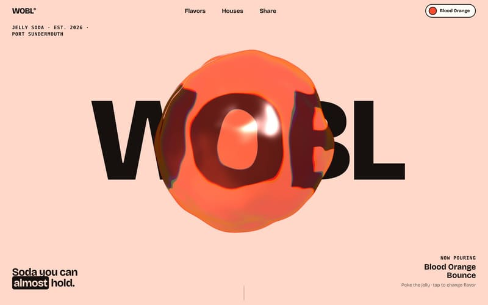</a>
       <b>WOBL</b> 
      webGL shader homepage that stays fast on mid-range phones 
      ↗ <a href="https://creative-homepage-demo.vercel.app">creative-homepage-demo.vercel.app</a>
    </td>
    <td width="50%" valign="top">
      <a href="https://free-app-kit-demo.vercel.app">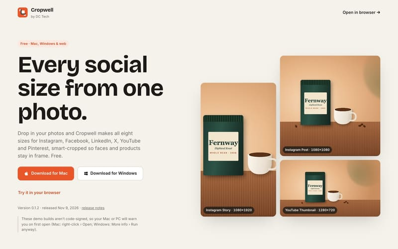</a>
       <b>Cropwell</b> 
      one photo into every social size, on the device, on web, Mac and Windows 
      ↗ <a href="https://free-app-kit-demo.vercel.app">free-app-kit-demo.vercel.app</a>
    </td>
  </tr>
  <tr>
    <td width="50%" valign="top">
      <a href="https://two-device-video.vercel.app">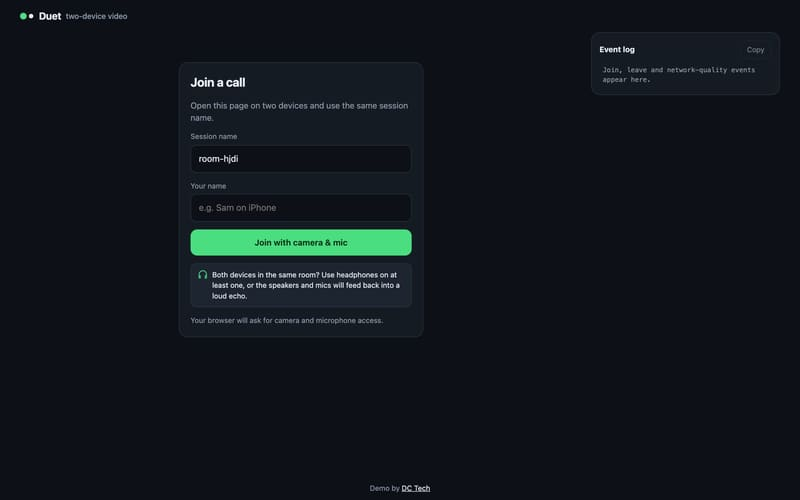</a>
       <b>Duet</b> 
      two-device video call on the Zoom Video SDK that works on desktop Chrome and iPhone Safari 
      ↗ <a href="https://two-device-video.vercel.app">two-device-video.vercel.app</a>
    </td>
    <td width="50%"></td>
  </tr>
</table>

## stack

typescript · javascript · python · react · next.js · node · react native · postgres · supabase · mysql · stripe · square · twilio · openai and anthropic apis · ffmpeg · livekit · three.js · solidity · vercel · hetzner · docker
